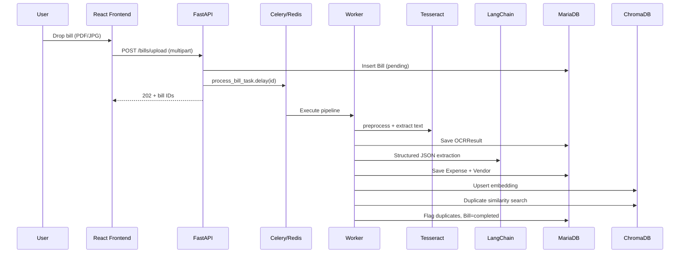

# Expense Bill Analyzer — System Architecture

## 1. System Architecture Overview

```
┌─────────────┐     HTTPS/JWT      ┌──────────────────────────────────────────┐
│  React SPA  │ ◄────────────────► │           FastAPI API Gateway             │
│  (Vite)     │                    │  auth │ bills │ expenses │ ai │ reports  │
└─────────────┘                    └───────┬──────────────────────┬─────────────┘
                                           │                      │
                    ┌──────────────────────┼──────────────────────┤
                    ▼                      ▼                      ▼
            ┌───────────────┐      ┌───────────────┐      ┌─────────────────┐
            │   MariaDB     │      │  Redis        │      │  ChromaDB       │
            │  (SQLAlchemy) │      │  Celery queue │      │  (embeddings)   │
            └───────────────┘      └───────┬───────┘      └─────────────────┘
                                           │
                                           ▼
                                   ┌───────────────┐
                                   │ Celery Worker │
                                   │ OCR→LLM→Embed │
                                   └───────────────┘
                                           │
                    ┌──────────────────────┼──────────────────────┐
                    ▼                      ▼                      ▼
            ┌───────────────┐      ┌───────────────┐      ┌───────────────┐
            │  Tesseract    │      │ OpenAI/Ollama │      │  File Store   │
            │  + OpenCV     │      │  (LangChain)  │      │  (uploads/)   │
            └───────────────┘      └───────────────┘      └───────────────┘
```

**Design principles**

- **Service-oriented backend**: Routers → Services → AI/Repository layers; no business logic in route handlers beyond HTTP concerns.
- **Async I/O**: FastAPI + `aiomysql` for concurrent API requests; CPU-bound OCR/LLM offloaded to Celery workers.
- **Dual storage**: Relational data in MariaDB; semantic vectors in ChromaDB with metadata linking back to `expenses.id`.
- **Defense in depth**: JWT, rate limiting (SlowAPI), magic-byte file validation, parameterized SQL (ORM), RBAC-ready `UserRole` enum.

---

## 2. High-Level Workflow



---

## 3. Database Schema

### ER description

| Entity | Relationships |
|--------|----------------|
| **users** | 1:N bills, expenses, audit_logs |
| **bills** | N:1 user; 1:1 ocr_results, expenses, bill_embeddings |
| **expenses** | N:1 user, vendor, category; optional self-ref for duplicate_of |
| **vendors** | 1:N expenses (normalized_name for dedup) |
| **expense_categories** | Lookup + keyword hints |
| **ocr_results** | 1:1 bill |
| **bill_embeddings** | 1:1 bill; stores Chroma document ID |
| **audit_logs** | N:1 user (nullable for register) |

### Indexes (implemented on models)

- `users.email`, `users.role`
- `bills.user_id`, `bills.status`, `bills.created_at`
- `expenses.user_id`, `expenses.expense_date`, `expenses.total_amount`, `expenses.category_name`, `expenses.is_duplicate`
- `vendors.name`, `vendors.gst_number`, `vendors.normalized_name`

### SQLAlchemy models

Located in `backend/app/models/`. Key constraints:

- `bills.id` → unique `expenses.bill_id` (one expense per bill)
- `ocr_results.bill_id` UNIQUE
- `bill_embeddings.bill_id` UNIQUE
- Enum types: `BillStatus`, `UserRole`

---

## 4. Backend Design

### Folder structure

```
backend/
├── app/
│   ├── main.py              # FastAPI app, CORS, rate limit, lifespan
│   ├── config.py            # Pydantic Settings
│   ├── database.py          # Async engine + get_db
│   ├── api/
│   │   ├── deps.py          # JWT current user
│   │   └── v1/
│   │       ├── auth.py
│   │       ├── bills.py
│   │       ├── expenses.py
│   │       ├── ai.py
│   │       └── reports.py
│   ├── models/
│   ├── schemas/             # Pydantic v2 request/response
│   ├── services/
│   │   ├── bill_service.py  # Full processing pipeline
│   │   ├── expense_service.py
│   │   └── report_service.py
│   ├── ai/
│   │   ├── ocr_pipeline.py
│   │   ├── llm_extractor.py
│   │   ├── classifier.py
│   │   └── vector_store.py
│   ├── tasks/celery_app.py
│   └── utils/
├── alembic/
└── requirements.txt
```

### Service layers

1. **API layer**: Validation, auth, HTTP status codes.
2. **Service layer**: Orchestration, transactions, analytics queries.
3. **AI layer**: Stateless OCR/LLM/embedding operations.
4. **Persistence**: SQLAlchemy models; Chroma for vectors.

---

## 5. Frontend Design

### Structure

```
frontend/src/
├── api/client.ts       # Axios + JWT interceptors + refresh
├── context/AuthContext.tsx
├── components/FileUpload.tsx   # react-dropzone + progress
├── pages/
│   ├── Dashboard.tsx   # KPI cards, pie/bar charts, upload
│   ├── Expenses.tsx    # NL search, filters, export
│   ├── Login.tsx / Register.tsx
└── App.tsx             # Routes + sidebar shell
```

### UX features

- Drag-and-drop multi-file upload with progress bar
- Dashboard: total spend, duplicate alerts, category pie, monthly bar chart
- Semantic search input (posts to `/expenses/search`)
- Category filter + CSV/Excel/PDF export via authenticated blob download
- Auth-ready: token storage, refresh interceptor, protected routes

---

## 6. AI/OCR Pipeline

### OCR (`ai/ocr_pipeline.py`)

1. Load image or PDF pages (`pdf2image`)
2. Preprocess: grayscale → denoise → Otsu threshold → OSD orientation fix
3. Tesseract `--psm 6` with per-word confidence aggregation
4. Return `raw_text`, `confidence_score`, `preprocessing_applied[]`

### LLM extraction (`ai/llm_extractor.py`)

- LangChain `ChatPromptTemplate` + `JsonOutputParser` → `ExtractionSchema`
- Strict prompt: no hallucination, null for missing fields
- Retry + regex JSON fallback
- Final fallback: keyword classifier only

### Classification (`ai/classifier.py`)

- Primary: LLM with pipe-delimited response
- Fallback: keyword map (Fuel, Hotel, Food, …)
- Supports multi-category via `secondary_categories`

### LangChain integration plan

| Step | Component |
|------|-----------|
| Provider switch | `LLM_PROVIDER=openai\|ollama` in config |
| Extraction | `ChatOpenAI` or `ChatOllama` + structured parser |
| Classification | Separate prompt chain |
| Future | LangGraph for multi-step validation agent |

---

## 7. API Specifications

Base URL: `/api/v1`

### Authentication

**POST `/auth/register`**

```json
{ "email": "user@example.com", "password": "securepass", "full_name": "Jane" }
```

**POST `/auth/login`** → `{ "access_token", "refresh_token", "token_type": "bearer" }`

**POST `/auth/refresh`** → `{ "refresh_token": "..." }`

### Bills

**POST `/bills/upload`** — `multipart/form-data`, field `files` (multiple)

Response:

```json
{
  "bills": [{ "id": 1, "original_filename": "invoice.pdf", "status": "pending", ... }],
  "message": "1 bill(s) queued for processing"
}
```

**GET `/bills/{bill_id}`** — requires Bearer token

### Expenses

**GET `/expenses?category=Hotel&min_amount=5000&date_from=2026-03-01`**

**POST `/expenses/search`**

```json
{ "query": "Fuel expenses from HP petrol pumps last month", "skip": 0, "limit": 20 }
```

**GET `/expenses/summary`** — dashboard analytics payload

**PATCH `/expenses/{id}`** — manual category override

### AI

- `POST /ai/ocr/{bill_id}`
- `POST /ai/classify` — `{ "text": "...", "vendor_name": "..." }`
- `GET /ai/duplicates/{bill_id}`

### Reports

**GET `/reports/export?format=csv|xlsx|pdf&category=Travel&date_from=2026-01-01`**

OpenAPI: http://localhost:8000/docs

---

## 8. Duplicate Detection Design

1. Build composite document: vendor + amount + category + date + OCR excerpt
2. Embed with `sentence-transformers/all-MiniLM-L6-v2`
3. Store in Chroma collection `bill_expenses` with metadata (`bill_id`, `expense_id`, `user_id`)
4. On new bill: `find_duplicates()` queries top-K cosine neighbors (excluding self)
5. Threshold: `DUPLICATE_SIMILARITY_THRESHOLD` default **0.85**
6. Persist: `expenses.is_duplicate`, `duplicate_of_id`, `duplicate_confidence`

Signals combined in embedding text:

- Same vendor name
- Similar amount
- Similar date string
- Similar OCR body

---

## 9. Semantic Search Design

**Hybrid retrieval**

1. **Vector path**: Embed query → Chroma `query` with `user_id` filter → map `expense_id` from metadata → hydrate from MariaDB preserving rank
2. **SQL fallback**: `ILIKE` on vendor, category, notes when no vector hits

**Example queries supported**

| Query | Mechanism |
|-------|-----------|
| "hotel expenses from March" | Embedding + optional date filter extension |
| "Bills above ₹5000" | Embedding + SQL `min_amount` when parsed in future NL→filter |
| "HP petrol fuel" | Embedding captures vendor + category semantics |

**Future**: LLM query parser → structured `ExpenseFilter` + vector search.

---

## 10. Dashboard Design

| Widget | Data source |
|--------|-------------|
| Total expenses card | `summary.total_expenses` |
| Bill count | `summary.expense_count` |
| Duplicate alerts | `summary.duplicate_count` |
| Category pie | `summary.by_category` |
| Monthly trend bar | `summary.monthly_trend` |
| Recent uploads table | `summary.recent_bills` |
| Upload zone | `FileUpload` → `POST /bills/upload` |

---

## 11. Deployment Architecture

### docker-compose services

| Service | Role |
|---------|------|
| mariadb | Primary relational store |
| redis | Celery broker + result backend |
| backend | FastAPI (port 8000) |
| celery_worker | Bill processing pipeline |
| frontend | nginx serving React build (port 3000) |

### Volumes

- `mariadb_data`, `uploads`, `chroma_data`

### Production recommendations

| Component | Suggestion |
|-----------|------------|
| Frontend | Vercel/Netlify or K8s + CDN |
| Backend | Gunicorn+Uvicorn workers behind ALB/nginx |
| DB | Managed MariaDB/RDS with backups |
| Vector | Chroma persistent volume or migrate to PGVector |
| Secrets | Vault / AWS Secrets Manager — never commit `.env` |
| TLS | Terminate at ingress (Let's Encrypt) |

### Environment variables

See `backend/.env.example`.

---

## 12. Recommended Enhancements

1. **LangGraph validation agent** — cross-check totals vs line items
2. **PaddleOCR option** — better accuracy on low-quality receipts
3. **PGVector** — co-locate vectors with MariaDB/Postgres for ACID
4. **LLM query planner** — parse NL search into SQL filters
5. **Webhook notifications** — processing complete / duplicate found
6. **Multi-tenant orgs** — `organization_id` on all rows
7. **S3/MinIO** — object storage for uploads
8. **Prometheus + Grafana** — pipeline latency, OCR confidence histograms
9. **Human-in-the-loop review UI** — correct extractions → fine-tune prompts
10. **GST/ tax compliance reports** — India-specific export templates

---

## 13. Sample Code Snippets

### Trigger async processing after upload

```python
process_bill_task.delay(bill.id)
```

### OCR entry point

```python
from app.ai.ocr_pipeline import extract_text_from_file
result = extract_text_from_file("/app/uploads/1/abc.pdf")
# result.raw_text, result.confidence_score
```

### Structured extraction

```python
from app.ai.llm_extractor import extract_structured_data
data = extract_structured_data(ocr_text)
# data.vendor_name, data.total_amount, data.expense_category, ...
```

### Vector upsert

```python
from app.ai.vector_store import upsert_bill_embedding, search_similar
chroma_id = upsert_bill_embedding(bill_id, user_id, document, metadata)
hits = search_similar("hotel march", user_id=1, n_results=10)
```

---

## 14. Final Production Recommendations

1. **Rotate `SECRET_KEY`** and use short-lived access tokens + refresh rotation blacklist in Redis.
2. **Run Alembic migrations** in CI/CD instead of `create_all` only.
3. **Scale Celery workers** horizontally; separate queues for OCR vs LLM if needed.
4. **Cap embedding model memory** — preload once per worker process (already singleton in `vector_store.py`).
5. **Scan uploads with ClamAV** before OCR.
6. **Enable MariaDB SSL** and least-privilege DB user.
7. **Monitor LLM costs** — cache extractions by file hash.
8. **Set `OPENAI_API_KEY`** via secrets; use `LLM_PROVIDER=ollama` for air-gapped deploys.
9. **Backup Chroma volume** with DB — metadata in `bill_embeddings` enables re-index if needed.
10. **Load test** upload endpoint with 10MB limit and rate limiter tuned per tenant.

---

*Implementation lives in this repository; start with `docker compose up --build` and open `/docs` for interactive API exploration.*
